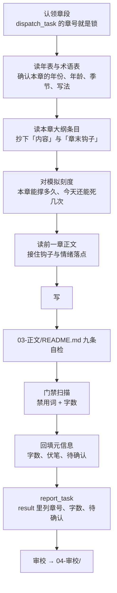

# 一章怎么从大纲走到入库

《杂役模拟三千世》不是从零起步的项目：`01-设定/` 六份、全书大纲、八卷卷纲、前 36 章逐章细纲都已封存定稿，卷一前半部分正文也已落地。本文只写**在这个状态下开工的落差**——哪些上游步骤已经做过了、一章实际怎么走、红线在流程的哪一步生效、门禁是什么、以及本机踩过的坑。

平台写法不在这里，见 [`fanqie-webnovel-writing/SKILL.md`](../.cursor/skills/fanqie-webnovel-writing/SKILL.md)；角色分工见 [parallel_prompt.md](../parallel_prompt.md)。

## 记号

本文用到的编号都在别处权威定义，这张表只给一句话和入口，不展开成第二套定义。

| 记号 | 是什么 | 权威定义 |
| --- | --- | --- |
| 卷一~卷八 | 八卷划分与章号区间 | [全书大纲 · 分卷总表](../02-大纲/00-全书大纲.md) |
| 单元 N｜第 a–b 章 | 8–15 章的叙事单位，卷纲的基本颗粒 | 各卷卷纲的「事件单元总表」 |
| 模拟刻度 | 本卷能撑多久、今天还能死几次、一天能完整模拟几次 | [`01-设定/02-模拟器机制.md`](../01-设定/02-模拟器机制.md) 第 2、3、4、4a 条 |
| 主 / 中 / 转折 / 暗 四条伏笔 | 埋、第一次动、半揭、全揭、了结的章号 | [全书大纲 · 伏笔收放时间表](../02-大纲/00-全书大纲.md) |
| 必改 / 建议 / 可忽略 | 审校严重度 | [triage-labels.md](./triage-labels.md) |

## 已经做过的上游步骤

对着已有产物再跑一遍，产出的是第二套口径。

| 上游步骤 | 本仓的等价产物 | 因此 |
| --- | --- | --- |
| 定题材与卖点 | `01-设定/01-核心设定.md` 的 13 格 + 附录 E/F 的番茄实测基准 | 结论已成型，引用它，不重做市场判断 |
| 铺全书结构 | `02-大纲/00-全书大纲.md` 的分卷总表与伏笔收放时间表 | 不重铺。只有出现总纲未覆盖的新方向才考虑 |
| 拆卷内事件单元 | `02-大纲/0N-卷N-*.md` 的事件单元总表 | 直接认领单元，不重拆 |
| 拆前 36 章逐章 | `02-大纲/09-前36章逐章细纲.md` | 直接认领章号 |
| 建设定 | 术语表 229 条、年表 41 个时间点、机制文档六条规则 | 前置已满足，改动走 [domain.md 的改设定流程](./domain.md#改设定要走的流程) |

**前 13 步（故事种子到关系情感线）全部手工填写，不许让模型自动生成。** 这是 `01-核心设定.md` 顶部的明文警告，来自一次真实事故：2026-08-27 的运行日志里把「角色设计」交给模型自动跑，它吐出了系统 / 入狱 / 毒针 / 云昭破坏食堂这一整套与本书无关的设定。前 13 步没有输入时，模型会自己编一套最常见的套路。

## 一章怎么走



**第二步不许跳**，理由见 [domain.md 那四次事故](./domain.md#开工前读这几份)。

**回填元信息那一步最容易忘。** `字数` 字段是**人工填的**，照模板复制过去、写完忘了改，交上来的就是占位的 `字数: 0`——0031–0035 五章曾经整段这样挂着（2026-08-28 已补齐）。这个字段不回填，段均值就算不出来，而段均值是前 36 章唯一能提前发现「这一段在漂」的指标。下面那段扫描的「字数没回填」就是查它的，别跳过。

**本章遇到的设定分歧填进元信息的 `待确认`，不许自己拍板。** 已有一个写得很好的样板：`0031-一个名额.md` 的 `待确认` 里完整记着「2026-08-27 裁定：采纳，已回填 `03-世界观.md` 1.2」以及为什么这一改不算推翻原设定。**这一格是给下一个人看的，不是给自己看的。**

## 动大纲的流程不一样

改 `02-大纲/` 走另一条路，跑的不是门禁扫描，是两张表：

1. **该卷的伏笔账**（卷纲里的「本卷伏笔收支」一节）——对照 `00-全书大纲.md` 第六节，收支两边都要对得上
2. **该卷的节奏检查表**（卷纲里的「节奏检查」一节）——爽点间隔、中高潮位置、连着几章憋屈

**「连着两段憋屈」这条要拆开看，不要按段落数直接判。** 前 36 章细纲的裁决记录里记着一次自己吓自己：17–20 整段被叫作「憋屈段」，拆开一看第 19 章「那我就多死几次」其实是爽点（他的回答不是认命，是加价），第 20 章是危机不是憋屈（读者是紧张，不是替他难受），**真正连着憋屈的只有 17–18 两章，本来就没破线**。

改卷纲连带要改的：分卷总表的章号区间、伏笔收放时间表、以及所有引用了该章号的卷纲。**章号区间写在 `00-全书大纲.md` 第五节，只有那一处**——不要在别处复制一份。

## 红线在哪一步生效

[AGENTS.md 那张红线表](../AGENTS.md#红线)不是审查清单，是流程里的具体动作。

**面板不替叙事、不是现代文、不自创境界、出场时机**——在**写**那一步，也在**门禁扫描**那一步。这几条里纯字面的部分机器能查，见下一节。

> **2026-09-12 按 v2 口径重划机器与人的分界。**（原来这里那段「2026-09-10 起第一条换人了……本书就是系统文」是 v1.5，已换。）**机器拦得住的只有七样**：**面板超量**（`【】` 内文本合计超两百字）、**选项超长**（`【】` 内单行超十二字）、**现代词与机制 0.4 那串**（`$bad`）、**出场太早**（`$early` 天命司／太衍观／借命 ≤190 章、`$early3` 算天盘／残片／穿麻的 ≤360 章、`$early2` 上一任的名字 ≤840 章）、**章号漏出**、**标点**、**字数**。另有一项**只列不判**：剥掉 `【】` 与引号内对话之后，旁白里的「你」。**机器拦不住的**——模拟内文字占比够不够一半、带回的那一样是不是他死时确实拥有、雾里的人写得准不准、死了有没有回声——**全部归[审校道一](../04-审校/README.md)**，只有人对着机制文档能查。扫描先剥 `【】` 再扫旁白这一步不变：那一层是它在说话，面板用语合法。

**模拟不是万能挂**（一夜一世、中途出不来、雾、回声、魂载）——在**写之前对机制**那一步（机制第五节自检）。机器查不了，只有人对着机制文档能查。这是本书最容易出错也最致命的一类：v1 时 `04-人物.md` 那处「云昭在模拟里看见赵堂年轻时」就是雾被破了，而它是设定文档自己写出来的，撑了很久才被抓到。

**出场时机**（第 1–190 章不许有「天命司」「算天盘」「残片」「太衍观」「借命」「穿麻的」；「算天盘」「残片」「穿麻的」卷四前不许；卷七前不许有上一任的名字）——在**写**那一步，扫描的 `$early`／`$early3`／`$early2` 三项能兜底，按章号分三档生效。其余「本卷不许说破」的东西（无字碑「磨平」、井水照灰气、老规矩的来由……）机器兜不住，只有[审校道二](../04-审校/README.md)那一条对得出来。

**带回只有一样，且必须是死时拥有的**——分两步。**「是不是死时拥有、现实里是不是没有」在写那一步**，人对着 `01-设定/02-模拟器机制.md` 第 4 条查，机器查不了。**「成色有没有失控」在卷末对伏笔账与累计世数那一步**，不在写那一步——这条仍然是唯一一条声明拦不住的：滑坡不会从谁故意加码开始，会从「这一世他活得太好了，三个选项都太好了」开始，**那一步不会有任何东西报错**。执行点是每卷的伏笔收支与世数（全书大纲第三、五节）。

**不在正文现编设定**——在**回填元信息**那一步。写的时候拿不准就先写，但收工前必须把新出现的人名地名数字挑出来，要么在设定里查到，要么进 `待确认`。

## 门禁

**本仓没有针对正文的机检脚本。** 现有的 node 脚本只有两类，都与正文质量无关：`.cursor/skills/fanqie-webnovel-writing/scripts/bench.mjs`（重算番茄基准线）和 `.scrape/` 下的采集与归档脚本。没有 `package.json`，也就没有 `npm run check`。

门禁因此是**三张人工清单 + 一段可跑的扫描**：

| 门 | 在哪 | 谁跑 |
| --- | --- | --- |
| 九条自检 | `03-正文/README.md` 第三节「写一章的五步」末尾那张清单 | 主笔，写完立刻 |
| 四道审校 | `04-审校/README.md` 第一节 | 审校，每 10 章一轮 |
| 第 36 章关卡 | `04-审校/README.md` 第三节 | 审校，全量四道 + 通读 + 核总字数 |
| 门禁扫描 | 本节 | 谁改正文谁跑 |

### 扫描：禁用词、字数、出场时机、章号漏出、标点不统一、面板超量、选项超长、旁白「你」

在仓库根跑。它跳过元信息头，也跳过 `README.md`（那是规范文件，本来就要引用禁用词）。

**剥元信息头这一步是必需的，不是优化。** 每一章的元信息都写着 `状态: 待审校`，而「状态」**从 2026-08-28 起真的在 `$bad` 里了**——在那之前这句注释说的是一件并没有发生的事（数组里根本没有这个词），现在它字面成立。实测：不剥头，30 章命中 30 条；剥头，0 条。**所以新写的章一定要带完整的 `---` 元信息头**，缺了头 `$body` 会回退成整个文件，当场变成每章一条假必改。

```powershell
[Console]::OutputEncoding=[Text.Encoding]::UTF8
# $bad 三段来源，以后审这个数组各对一遍：① 术语表 7.3 换法表二十行（概率→反馈，逐字）；② 7.3 末行英文与游戏词（「刷」一个字太宽，洗刷、牙刷都中，改收「刷怪」）；③ 机制 0.4 那串（「能量」与 ① 重复只收一次，「每日刷新」收作「刷新」）；另加面板不称「宿主」（术语表 4.1、第六节）与一页速查六个错字
$bad = '概率','数据','效率','信息','状态','资源','概念','系统化','优化','目标','方案','分析','判断','逻辑','变量','精神力','能量','时间线','确认','反馈','CD','buff','debuff','读档','存档','刷怪','通关','新手村','模拟点','经验','等级','色阶','天赋','随机','进度条','冷却','商店','刷新','任务','副本','奖励','结算','宿主','练气','玄丘门','玄丘派','玄邱','陈久','陈玖'
$early  = '天命司','太衍观','借命'
$early3 = '算天盘','残片','穿麻的'
$early2 = '莫争'
$meta  = '第\s*[0-9零一二两三四五六七八九十百千]+\s*[章卷]'
$fixed = '^(是否以此刻为始|第.+世|三千世|此生中断|可带回一样|已带回)'
Get-ChildItem -Recurse -Filter *.md '03-正文' | Where-Object Name -ne 'README.md' | Sort-Object Name | ForEach-Object {
  $f = $_
  $t = [System.IO.File]::ReadAllText($f.FullName)
  $decl = if ($t -match '字数:\s*(\d+)') { [int]$Matches[1] } else { -1 }
  $body = if ($t -match '(?s)\A---\r?\n.*?\r?\n---\r?\n') { $t.Substring($Matches[0].Length) } else { $t }
  $real = ($body -replace '\s','').Length
  if ($real -lt 1900 -or $real -gt 2600) { "字数出界  {0}  {1}" -f $f.Name, $real }
  if ($decl -ne $real)                   { "字数没回填 {0}  声明 {1} / 实计 {2}" -f $f.Name, $decl, $real }
  # 面板是「它」在说话，那一层的用语合法；扫旁白之前先把【】剥掉
  $panels = [regex]::Matches($body,'【[^】]*】') | ForEach-Object { $_.Value }
  $panelLen = (($panels -join '') -replace '\s','').Length
  if ($panelLen -gt 200) { "面板超量  {0}  面板文本 {1} 字（上限 200）" -f $f.Name, $panelLen }
  # 选项每行不超十二字（机制 0.2）；固定句（始／终／中断／可带回一样／已带回／抬头）不按选项算
  foreach ($pl in $panels) {
    $inner = ($pl.Trim('【','】') -replace '\s','')
    if ($inner -notmatch $fixed -and $inner.Length -gt 12) { "选项超长  {0}  {1} 字（上限 12）  {2}" -f $f.Name, $inner.Length, $pl }
  }
  $chap = [int]$f.BaseName.Substring(0,4)
  $n = 0
  $p = 0
  foreach ($line in ($body -split "`r?`n")) {
    $n++
    if ($line.Trim() -ne '') { $p++ }
    $narr = $line -replace '【[^】]*】',''
    foreach ($w in $bad) { if ($narr.Contains($w)) { "禁用词    {0}  第{1}行 / 第 {2} 段  [{3}]  {4}" -f $f.Name, $n, $p, $w, $line.Trim() } }
    if ($line -match $meta) { "章号漏出  {0}  第{1}行 / 第 {2} 段  [{3}]  {4}" -f $f.Name, $n, $p, $Matches[0], $line.Trim() }
    foreach ($q in [regex]::Matches($line, '["「」,]')) { "标点      {0}  第{1}行 / 第 {2} 段 / 第 {3} 列  [{4}]  {5}" -f $f.Name, $n, $p, ($q.Index + 1), $q.Value, $line.Trim() }
    # 旁白里的「你」只列不判：对话里的你合法，先剔掉 “…” 里的字再查（机制 0.3 模拟内部第三人称）
    $narrNoQuote = $narr -replace '“[^”]*”',''
    if ($narrNoQuote.Contains('你')) { "旁白你    {0}  第{1}行 / 第 {2} 段  {3}" -f $f.Name, $n, $p, $line.Trim() }
    if ($chap -le 190) {
      foreach ($w in $early) { if ($line.Contains($w)) { "出场太早  {0}  第{1}行 / 第 {2} 段  [{3}]  {4}" -f $f.Name, $n, $p, $w, $line.Trim() } }
    }
    if ($chap -le 360) {
      foreach ($w in $early3) { if ($line.Contains($w)) { "出场太早  {0}  第{1}行 / 第 {2} 段  [{3}]  {4}" -f $f.Name, $n, $p, $w, $line.Trim() } }
    }
    if ($chap -le 840) {
      foreach ($w in $early2) { if ($line.Contains($w)) { "出场太早  {0}  第{1}行 / 第 {2} 段  [{3}]  {4}" -f $f.Name, $n, $p, $w, $line.Trim() } }
    }
  }
}
```

**出场时机那几个词为什么单开、不并进 `$bad`（2026-09-12 v2 换词，道理不变）：** 它们不是永远禁用的词——「天命司」第 190 章前后从人嘴里说出来之后就是正常用词，「太衍观」「借命」卷三起、「算天盘」「残片」「穿麻的」卷四起也一样（世界观第六节出场时机表）。并进 `$bad` 会从卷二末开始每章误报，而[一行给满屏噪声的规则会让人开始无视整份报告](./triage-labels.md#门禁具体不查什么)。所以按解禁的卷分三档、各按章号生效（MCP-1 2026-09-12 裁）：**`$early`（≤190）＝天命司、太衍观、借命**——天命司 190 前后解禁，太衍观与借命卷三（201 起）才解禁，191–200 那十章归审校道二；**`$early3`（≤360）＝算天盘、残片、穿麻的**——卷四（361 起）解禁；**`$early2`（≤840）＝莫争**——上一任的名字卷七前不许（核心设定六、人物四）。三组是同一套机关，只是线不同。v1 这里是「仙盟」「魔门」≤30 章，2026-08-28 补进来时前 30 章没有漏网，是主笔守住的，不是扫描守住的——那一层教训还在：**这一项写进扫描之前只写在红线里，扫描并不查**。

**新加的两项，一判一列。** `选项超长`：`【】` 内每一条剥掉空白后超十二字就报（机制 0.2「选项那三行每一行不超十二个字」、术语表第六节「死因一句话不超十二字」），**标点也算字**——`【死于：后山灵田，夜耙子】` 十一字合式；固定句 `【是否以此刻为始，模拟此生？】`（十三字）、`【第 N 世 · 始／终 · 享年 X】`、`【此生中断】`、`【可带回一样】`、`【已带回：……】`、卷二末的抬头 `【三千世 · ……】` 不按选项算，用 `$fixed` 那条正则放行。`旁白你`：剥掉 `【】` 之后再剔掉 `“…”` 引号内的字，剩下的旁白里有「你」就列一条，**只列不判**——对话里的「你」合法，而一句对话跨行、引号在上一行开在下一行关的，这一步剔不干净，会多列；模拟内部写「他」不写「你」是机制 0.3 第一条，列出来让人看一眼比不列强。

**那为什么补进来的六个现代词反而直接进 `$bad`：** 确认、状态、目标、计划、判断、心理阴影这六个，2026-08-28 补进 `$bad`。它们本来就在[术语表 8.4 现代词表](../01-设定/05-术语与命名表.md)上，数组一直漏收。**和「仙盟」「魔门」正相反——这六个永远不会变成正常用词，任何一次命中都是真报**，不存在「写到某一卷就开始每章误报」这回事，所以不需要 `$early` 那套按章号生效的机关。

判它们该不该进，走的是**先扫后加**：六个词在全树 30 章上各自 **0 命中**（六个都是 0，不是合计 0），属于[加了不会给满屏噪声](./triage-labels.md#门禁具体不查什么)那一档。**这个顺序不要反过来**——先加后扫，遇上高频词就只能回滚，而回滚过的规则没人再信。

**补完之后有一条现成的便宜可占**：`$bad` 里从「概率」到「判断」这一段，现在是术语表 8.4 全表二十三行的逐字誊写，一个不多一个不少。**以后审这个数组，跟 6.3 和 8.4 各对一遍。**

> **（v1 节号，2026-09-12 起失效。）** 上面这段与下面几段引的「术语表 6.3／8.4」是 v1 术语表的节号，v2 术语表没有这两节。**v2 的 `$bad` 三段来源写在代码块顶上那行注释里：术语表 7.3 换法表二十行、7.3 末行英文与游戏词、机制 0.4 那串，另加「宿主」与一页速查六个错字，共四十九个词。以后审这个数组，跟术语表 7.3、机制 0.4、一页速查各对一遍。** v1 数组里的「属性」「配额」「额度」「信息量」「精度」「空间」「情报」「计划」「团队」「优势」「劣势」「心理阴影」「宿命」「开挂」「金手指」「数值」「技能」「加点」「升级」「回档」「重生点」「存档点」「天赋树」「经验值」在 v2 两张表上都没有，**一并移出**——不是它们变合法了，是 v2 的准据只认术语表与机制文档两处，表上没有的词扫描不该替表做主；要拦，先登进术语表。「模拟」「面板」「系统」三个词 v2 可写（术语表 7.1），v1 数组里本就没有，不用删。**这四十九个词没有做过「先扫后加」**：v2 树上还没有一章正文，扫不出噪声；第一段十章落地后要回头把「经验」「天赋」「奖励」「残片」这几个可能有本义用法的词各扫一遍，命中多的挪出 `$bad` 归审校。下面到「新增一项非词表检查」为止的几段是 v1 历史，规矩仍然成立，例子过期。

> **2026-09-10 改类型之后，这个数组重排过一次，8.4 那一段一个没动，动的全是 6.3 那一段。**
>
> **移出 `$bad`（现在合法）**：系统、面板、模拟器、奖励、重开。前四个是本书现在真有的东西；「重开」移出是因为它一直是个词形陷阱（「天地重开」「药铺重开」都是汉语本义），留着它误报比漏报贵。
>
> **留在 `$bad`，但改成只查 `【】` 之外**：宿主、属性、配额、额度。这四个在面板层合法、在旁白层不合法——**扫描先剥 `【】` 再扫，正好按这条分界线切**。
>
> **留在 `$bad`、永远不许写**：副本、任务、天赋树、加点、技能、经验值、等级、升级、读档、存档、存档点、回档、重生点、新手村、刷怪、通关、数值、冷却、CD、buff、debuff。理由不是「像系统文」，是**本书机制里根本没有这些东西**——写一个不存在的机制等于在正文现编设定，那条红线没废。英文那三个另外还犯「不是现代文」。
>
> **新增一项非词表检查**：`面板超量`，每章 `【】` 内文本合计超过 200 字就报。这是全书唯一一条针对新红线的机检，**也是这次改类型之后机器还能替人守住的唯一一样东西**——旧红线是「一个词都不许出现」，机器一抓一个准；新红线是「别写太多」，只有靠数字。

> **原来这句写的是「跟 8.4 对一遍就够了」，2026-09-07 改。那句话本身就是一盏假绿灯：它只担保了一半，读的人会以为担保了全部。**
>
> `$bad` 同时承担着 **6.3 游戏化词**与 **8.4 现代词**两张表，而当日全树核对的结果是：**8.4 全表 25 个词一个不缺**（那半句是对的），**6.3 却漏了 7 个——天赋树、CD、buff、debuff、任务、存档点、重生点**。其中「存档点」含「存档」能被子串顺带拓到，**其余 6 个是真漏的**；**最要紧的是「任务」**，它是个常用词，一旦写进正文（「这趟任务」之类）就是典型的游戏化语感，而扫描不报。
>
> 七个词已于同日按「**先扫后加**」补入：补之前先拿它们全树扫过，**七个各自 0 命中**，属于「加了不会给满屏噪声」那一档。由通道 2 报出（task-49dd978d 全库重验），MCP-1（通道 3 代行）当日裁定补入。
>
> **`宿命` 那一条的来历**：它在术语表 6.3、8.4 两张表里都查不到出处。**疑为防「宿主」误写而加，保留、不要删**——它全树 0 命中，留着零成本，删了万一将来有人写出「宿命」这种半系统腔就没人拦。**这一行就是它的来历记录**，下次再有人问「这个词哪来的」，看这里。

**「禁用词」「出场太早」两行同时给行号和段号，两个都要留着。** 行号是给你自己跳转用的（编辑器直接跳，但**它是正文体的行号，不是文件行号**——文件行号还要加回元信息头那几行）；**段号是给报告用的**，`04-审校/` 的定位格式是「章号 / 第 N 段 / 原句前 8–10 字」，[理由见审校规范](../04-审校/README.md)。

段号口径与审校报告完全一致：**去元信息头后，逐个非空行计段，`——` 分隔符也算一段。**

**为什么非要脚本自己算，不让人手工换：** 2026-08-28 已经真出过一次事故——两条通道报同一句话，一个用行号、一个用段号，看上去像在互相推翻对方的结论，重数了一整轮才分清楚坐标不同。**手工换算出错是早晚的事，不是谁不细心。**

**`$meta`（章号漏出）查的是「作者的坐标写进了角色的世界」。** 正文里不该有「第二章那一巴掌」「第 33 章那张纸条」这种说法——**章号是我们的刻度，不是云昭的**。它和禁用词不是一类：禁用词错在词，这个错在**视角**。

**这一条必须跑在剥头之后，而且剥头就是它能用的全部前提。** 每一章的元信息都写着「对应大纲：…第 N 章」「伏笔：…第 33 章收」，那些全是合法的。实测（2026-08-29，36 章）：**不剥头 67 条，剥头后 0 条。** 不剥头这条规则就是纯噪音。

> **「不剥头」那个数会随章数一直长，别把它当固定值核对。** 它约等于章数×2（每章元信息各有「对应大纲：…第 N 章」，另有若干章在「伏笔」里写了收放章号）。2026-08-28 记的是 64、当时 30 余章，2026-08-29 是 67、36 章。**要看的不是这个数本身，是它与剥头后那个数的落差**——落差在，剥头就还活着。

> **它的来历值得记一笔**：这条规则是主笔写 0028 时差点把「第 1 章那天」写进正文、自己拔掉并主动报上来才有的。**主笔当时判它「机器查不了」，恰恰相反——它是机器最好查的一类。** 而补上之后第一次跑，就在树上翻出一条早就躺着的（`0010` 第 21 段「第二章那一巴掌」）：门禁没查、那一段的审校也没报，**两道闸都漏了，只是因为没人想到要查它**。那一条已于 2026-08-29 修掉（改成「在里头挨赵堂那一巴掌」，用地点＋人替下章号），所以这一项现在的常态是 0。

**标点不统一查的是标点，不是词。** 正文的事实标准是**弯引号 `“ ”` 加全角逗号 `，`**，所以四个字符一个都不该出现在正文里：`"`、`「`、`」`、`,`。它和 `$bad` 同类、不走 `$early` 那套按章号生效的机关——**中文正文里这四个永远不会变成正常用法，任何一次命中都是真报**。

> **这一项的名字是故意起得比成员宽的，别改回去。** 它最初叫「半角引号」，只查 `"`，而树上当时还躺着 266 个直角引号和 34 个半角逗号——**名字比实际该查的范围窄，规则就跟着窄，然后它报零**。所以现在这个名字描述的是**问题的类别**（标点没统一），不是成员清单。以后再发现第五个字符（省略号写成 `...`、破折号写成 `--`），**往字符类里加一个就行，不用改名，也就不会再出现「名字盖不住范围」这回事**。输出里的 `[{4}]` 会告诉你抓到的具体是哪一个，信息一点没丢。

**它必须跑在剥头之后，而且这一条比另三类更依赖剥头。** 元信息里这些写法全是合法的：`「本章完成的事」`「伏笔」「待确认」几栏本来就用直角引号引述、`0007`／`0008`／`0021` 还用 `"` 引过原话。实测（2026-08-29 晚，36 章）：**元信息头里有 128 个直角引号 ＋ 8 个半角引号，共 136 处合法命中，半角逗号 0 个**。不剥头，这条规则开口就是一百多条纯噪音，**而且噪音全落在元信息上，正文一条真报都会被埋掉**。

> **这个数比 `$meta` 那个还爱动，同样别拿它当固定值核对。** 它不只随章数长，**每有人往「待确认」里补一条引述就多两个**——本节写下 128 之后不到一小时，另一条通道给两章补了待确认，它就变成了 136。**要看的仍然是它与剥头后那个 0 的落差**：落差在，剥头就还活着。

**输出比另三类多两样：「第 N 列」和命中的那个字符。** 另三类一行一条就够了，标点不行——一行里常有二到四个，只报行段号说不清是哪一个；四个字符共用一条规则，不标出抓到的是哪一个就没法直接动手。列号也让「共 N 个」这个数可核（一条输出＝一个字符，不是一行）。

> **这一条是先抄平、后上线的，顺序不能反。** 上线那天树上有 **488 处**，直接加进来它开口就是满屏，而[一行给满屏噪声的规则会让人开始无视整份报告](./triage-labels.md#门禁具体不查什么)。**这是「先扫后加」那条规矩第二次派上用场**，头一次是 2026-08-28 补六个现代词。
>
> **来历值得完整记一笔，因为它是这份文档里最典型的一次「看见的不是全貌」。** 事情从「三章半角引号」开始：主笔上一批十章写出来全用了半角（自报 550 个），事后批量转全角**漏掉了 `0022`–`0024` 三章**，188 处。**批量转换漏掉一部分，比全都没转更难发现**——树上大多数是对的，抽查很容易正好抽到对的那些。
>
> **抄平那三章之后，才发现引号在这棵树上根本不是裂成两套，是三套：**弯引号（`0001`–`0025`、`0031`–`0036`，事实标准）、半角（`0022`–`0024`）、**直角 `「」`（`0026`–`0030` 五章，266 个，这五章弯引号为零）**。另有 34 个半角逗号散在 `0027`–`0030` 与 `0001`／`0002`／`0036`。
>
> **每一套单独看都像标准。** `0026`–`0030` 连着五章通篇直角引号、内部完全自洽，只有跟别的章放在一起才看得出来不对。所以这类「全书统一性」的问题，**抽章检查天然查不出来，必须全树按字符计数**。
>
> **而它差一点造出第四盏假绿灯**：这条规则最初只拟查半角引号，那样写的话它上线当天就是零——而树上还躺着 266 个直角引号和 34 个半角逗号。**规则写了，但它实际没查到该查的东西**，和上面那张表里的三次是同一个形状。拦下它的不是这段扫描，是审校通道在读 `0021`–`0030` 时用眼睛看出来的。

字数口径是**正文去掉全部空白字符后的字符数，不含元信息头**。这不是约定俗成，是实测出来的：0001–0021 的声明值与这个算法逐章零误差。

段均值另算。**下面这段只出数，不判断**——合格线（前 36 章一档、37 章起另一档）在 `03-正文/README.md` 第四节的硬指标表里，那是唯一一份，出数之后对着它看：

```powershell
[Console]::OutputEncoding=[Text.Encoding]::UTF8
Get-ChildItem -Recurse -Filter *.md '03-正文' | Where-Object Name -ne 'README.md' | Sort-Object Name | ForEach-Object {
  $t = [System.IO.File]::ReadAllText($_.FullName)
  $body = if ($t -match '(?s)\A---\r?\n.*?\r?\n---\r?\n') { $t.Substring($Matches[0].Length) } else { $t }
  [pscustomobject]@{ 段 = [math]::Floor(([int]$_.BaseName.Substring(0,4) - 1) / 10) * 10 + 1; 字数 = ($body -replace '\s','').Length }
} | Group-Object 段 | ForEach-Object {
  "{0:0000}–{1:0000}  {2} 章  均值 {3:N0}" -f [int]$_.Name, ([int]$_.Name + 9), $_.Count, ($_.Group.字数 | Measure-Object -Average).Average
}
```

**一段没写满时均值不作数**，分母不是 10。上面这段照直算，看的时候要连「N 章」那一列一起看。

### 只列不判：相对日期复核

**这一段不是门，是清单。** 它把正文里所有相对日期词按章、段列出来，**一条都不判对错**——判要对着 [`01-设定/06-年表.md` 第三节卷一逐日账](../01-设定/06-年表.md)（卷二起对各卷纲的逐日账；v1 的 `02-大纲/10-逐章日账.md` 已删）。几条现成的判据，全从年表那张账来：「三年前」只能指入宗那一年（第 −3 年）；「初五」在卷一只能是 D12（十月初五）或 D42（冬月初五，初五之战）；「初一」在卷一只能是 D8、D38、D68 三天；「上个月」在 D30 之前只能指九月；「去年」在卷一整卷都不成立（全卷在第 0 年，不跨正月）；「半个月／二十天」一律换事件指代。**里头的日子与现实同历**（机制第 2 条「里头是真的」），所以模拟内的「第三年春」「初五」「第九十天」也要对得上他进去那一夜的月令——年表逐日账每一世的行里已把关键几天换算成 D 数，照那个对。改一章日子的人跑一遍自己那几章，审校通读一段时跑一遍那一段。

```powershell
[Console]::OutputEncoding=[Text.Encoding]::UTF8
$rel = '上个月','这个月','下个月','月初','月底','半个月','十来天','十几天','二十天','一个多月','两个月','三年前','两年前','前年','去年','年底','开春','入冬','今年','往年','初一','初五','月半','冬月','腊月','正月'
Get-ChildItem -Recurse -Filter *.md '03-正文' | Where-Object Name -ne 'README.md' | Sort-Object Name | ForEach-Object {
  $f = $_
  $t = [System.IO.File]::ReadAllText($f.FullName)
  $body = if ($t -match '(?s)\A---\r?\n.*?\r?\n---\r?\n') { $t.Substring($Matches[0].Length) } else { $t }
  $n = 0
  $p = 0
  foreach ($line in ($body -split "`r?`n")) {
    $n++
    if ($line.Trim() -ne '') { $p++ }
    foreach ($w in $rel) { if ($line.Contains($w)) { "相对日期  {0}  第{1}行 / 第 {2} 段  [{3}]  {4}" -f $f.Name, $n, $p, $w, $line.Trim() } }
  }
}
```

**为什么不并进 `$bad`：** 「去年」「今年」「入冬」在这本书里多数时候是对的（0002「去年冬天」、0050「去年入冬重派过一回」都对），进了 `$bad` 就是每章几条真假掺半的报，而[一行给满屏噪声的规则会让人开始无视整份报告](./triage-labels.md#门禁具体不查什么)。**但这一类恰恰是 09-04 通读里 73 条必改的最大来源**（六份报告里将近三分之一是日子），所以列出来让人看一遍，比不列强。它也答不了「第 N 天」那一类——0019、0029、0032、0049 的「第几天」是章内自数，全列出来只会淹掉别的；出了那一章再引「第几天」的错，只有人读得出。

**词表 2026-09-12 加六个书内月令词：初一、初五、月半、冬月、腊月、正月。** 它们在这本书里是硬坐标——初一是扫墓日、初五是试剑的人的日子，一处写错全卷的账都错，所以宁可多列。「初五」会连带列出面板里的 `【死于……】` 之外的所有初五，以及卷一纲里本来就该出现的那几处，**列出来的多数是对的**，这正是它只列不判的原因。**上线时树上没有正文（v2 重写中），没有基准数**；第一段落地后跑一遍，把那个数记在这里。

> **下面这一段是 v1 的基准数，章号与词频都是旧稿的，只留作「这类清单大约多长」的参照。**
>
> **上线那一刻的数（2026-09-05 12:50，52 章）：156 条。** 按词：三年前 27、去年 23、这个月 17、半个月 16、今年 14、往年 12、入冬 10、上个月 8；按章最多的是 0031（13）、0008／0023（各 12）、0052（10）。**这个数是清单长度，不是错误数**——其中 0047 那七处「三年前」是必改、0002 那两处「去年冬天」是对的，同一张表里。它会随落地单一条条变短，看它不是为了归零，是为了知道下一个人还要看哪几条。**词表里故意没有「年前」**：它是「三年前」的子串，加进去每条报两次；「过年前」这种说法这本书不写（正文不写过年）。

### 改这段扫描之前：先拿一个已知命中例反验

**全 0 的扫描和坏掉的扫描长得一模一样。** 加了新规则跑出来零命中，你没法从结果上区分「树很干净」和「这条规则什么都没查」——而后者会给你一盏假绿灯，比不加还糟。

**所以规矩是：新规则上线前，先喂它一个你已经知道一定会命中的例子，看它报不报。** 报了，这条规则才算活的；没报，先修规则，别急着信那个零。反向也做一次更稳：拿一个**本该被剥掉**的位置（比如元信息里的字段）试试，确认它没被误抓。

已经栽过四次。**前三次是同一个形状：规则写了，但它实际什么都没查。第四次形状不同，见表下那一段。**

| # | 假绿灯 | 怎么发现的 |
| --- | --- | --- |
| ① | 「红线在哪一步生效」声称扫描兜底出场时机，而 `$early` 当时根本不存在 | 有人去读脚本才发现 |
| ② | 本节开头的注释声称「状态」是禁用词、所以要剥头，而 `$bad` 里没有「状态」 | 做道四语义排查时撞上 |
| ③ | `$meta` 一度拟用区间写法 `[0-9一-九十百]`，**它恰好匹不到验收用例那一条**——`一` 是 U+4E00、`九` 是 U+4E5D，而 `二`(U+4E8C)`四`(U+56DB)`五`(U+4E94)`六`(U+516D)`八`(U+516B) 全在区间外，区间里反倒混进九十多个无关汉字 | 上线前按本节这条规矩反验，当场露馅 |
| ④ | 标点那一项**上线时叫「半角引号」、只查 `"`**。它按规矩反验过、探针也报得出来、上线后报零——**可树上还有 266 个直角引号和 34 个半角逗号，它一个都不查** | 审校通道读 `0021`–`0030` 时**用眼睛**看出来的，扫描不可能报 |

**③ 那个坑值得单记一句：中文数字在码位上不连续，写字符区间必错。** 一律逐字枚举，就像现在这样：`[0-9零一二两三四五六七八九十百千]`。补 `零两千` 是为了「第一百零八章」这类写法——这本书有 1100 章，迟早会写到。

**④ 和前三盏不是一回事，这个区别是它最值得留下来的地方。** 前三盏是**规则写错了**——反验一跑就现形，本节这套办法治得住。④ 的规则**写对了、跑对了、反验也真的通过了**：拿 `0022` 当探针报出 104 条，抄平后归零，两头取数一样不缺。**错的是它的名字和范围比问题本身窄**——问题是「标点没统一」，规则只写了「半角引号」。

**所以反验治不了 ④。** 反验只能回答「这条规则查它声称要查的东西了吗」，答不了「它声称要查的，是不是就是该查的全部」。后一个问题只有人去数一遍地盘之外才知道。

**而范围是派单给窄的，不是执行的人窄。** 那一单写死了三个文件、给了 188 这个数，执行侧照着数、照着验，每一步都对。**所以这条教训归派单，也归接单的人：拿到一个「范围＋数字」的单子，先自己在地盘之外扫一遍同类，再动手。** 代价很小——那次只要把 `「` 和 `,` 一起数一遍就够了，多花不到一分钟。

#### 树干净之后，反验反而更要紧

2026-08-29 之后，这段扫描的常态输出是**全零**。但这个「全零」是分两次才做到的，**中间隔着几十分钟，而那段时间里它就已经在报零了**：

| 时点 | 清掉了什么 | 清完之后扫描说 |
| --- | --- | --- |
| 当日 · 第一轮 | `0018` 的「概念」、`0010` 的「第二章」、`0022`–`0024` 的 188 个半角引号 | **全零** |
| 当日 · 稍晚 | `0026`–`0030` 的 266 个直角引号、散在八章的 34 个半角逗号 | 全零 |

**第一行那个「全零」是假的**——它报零的时候，树上还躺着 300 个坏标点，只是那条规则当时只查 `"`。**这句话本身在这份文档里挂了几十分钟，是它自己记录过的最短命的一条断言。** 详见下面假绿灯表第 ④ 条。

**这件事有个副作用：树上再没有现成的命中例可拿了。** 而「全 0 的扫描和坏掉的扫描长得一模一样」这句话不会因为树干净就失效，反倒更危险了——以前跑出非零还能确认它在干活，现在**每一次都是零，坏了也是零，不会有任何提示**。

所以反验从「改扫描之前做一次」升级成**常规动作**：四类各拿一个探针跑一遍，确认四条路都通，再去信那个零。

> **v2 注（2026-09-12）：下表四条探针的坐标全部失效。** `0018`、前 30 章、元信息头里那些引号，都是 v1 正文的，2026-09-11 已删；v2 树上第一章落地之前，树上没有任何一个现成的命中例。**这一段空窗期的反验用 `$env:TEMP` 下的假章**：按 `03-正文/README.md` 模板造一章、把要拦的东西一样一样埋进去、把扫描路径临时指过去跑，逐项对报出与否，跑完删（2026-09-12 门禁按 v2 重做时这样跑过一次，九个探针的结果在修订记录第 17 条）。第一章落地后把下表换成真章里的坐标，并把假章那套写进「回归用例的交接」。

| 通道 | 探针 | 应当报出 |
| --- | --- | --- |
| 禁用词 | `$bad` 换成 `'什么叫一年就筑基'` | `0018` **第 27 段**，1 条（2026-09-05 前是第 25 段，见下面「回归用例的交接」） |
| 章号漏出 | `$body = $t`（不剥头） | 数十条（现 67），与剥头后那个 0 拉开落差即可 |
| 出场太早 | `$early` 换成 `'内门'` | 前 30 章数十条（现 29），且 31 章起不报 |
| 标点不统一 | `$body = $t`（不剥头） | 一百多条（现 136：直角 128 ＋ 半角引号 8），**全在元信息头**，数会随待确认栏增补而长，看落差；正文体应为 0 |

**字数那一路不用另造探针**：任何一次改动之后、回填之前它都会自己报出来，回填之后归零，一来一回就是它活着的证据。

**探针只替换对应那一行赋值，其余一个字符都不要动。**

#### 上面四条证不了你刚写的那一章被扫到了

**四条探针的命中全部落在旧章上**（`0018`、元信息头、前 30 章）。它们能证明的只有一件事：**这套规则对树上已有的文件还活着。** 它们证不了扫描真的读到了你这一轮**新建**的那两章。

**而这两种情况在输出上长得一模一样：**

| 实际发生的 | 你看到的 |
| --- | --- |
| 新章很干净 | 新章零命中 |
| 新章压根没进 `Get-ChildItem` 的结果 | 新章零命中 |

漏进不了文件清单的路子不止一条：文件名前缀没解析出来、章号落在过滤区间外、新建在了别的目录、`---` 头缺失导致 `$body` 回退。**这些全都不报错，只是安安静静地少扫一个文件。**

**做法：再加一条自证探针，探针词从你自己刚写的正文里挑。** 把 `$bad` 换成一个你确定这两章里一定有、而且出现在正文体（不是元信息头）里的词，看它报不报得出来、报出的章号对不对。报得出，才说明这一轮的零是关于**你这两章**的零。

> 2026-08-30 通道 5 交 `0041`／`0042` 时自己加的这一条，随即被采纳成常规动作。它用的词是「纸条」，`0041` 报 6 条、`0042` 报 8 条，其中一条落在 `0042` 第 3 段的正文体——**同时证明了两件事：文件被读到了，剥头也没把正文一起剥掉。**
>
> **这一条和上面四条的分工要记清楚：四条查的是「规则还活着吗」，这一条查的是「它这次看的是我吗」。** 前者每轮都一样，后者每轮都得换词——**因为它要证的恰恰是那个每轮都在变的东西。**

#### 回归用例的交接：`$bad` 那条已经换过一次

`$bad` 原先的回归用例是 `0018 / 第 25 段 /「概念」`，**2026-08-29 修掉、退役**。接替它的用例**站在同一个坐标上**：

> `0018 / 第 27 段 /「什么叫一年就筑基」`

这不是巧合选的。那一句就是「概念」改后的原句（「你懂什么叫一年就筑基吗？」），**改动发生在原地，段号没动过**——接任那天它还是第 25 段。拿它当探针跑，报不出 **27** 就是计段逻辑坏了——和退役的那条是同一个判据，不用重新校准。

> **坐标换过一次，句子没换。** 2026-09-05 通读落地（终裁④）在 `0018` 第 16 段后面加了两段（「孙九一愣。“你知道？”」「“见过。”」），这一句从第 25 段漂到第 27 段，原文一字未动。三条落地通道当天都报了「探针报 27 非 25」——**探针报出的段号和文档不符，先查那一章有没有人加段，再怀疑计段逻辑**；两种情形的输出长得一样，分开它们只需要打开那一章数一遍。

**以后再修掉一条回归用例，照这个办：先看改后的句子能不能接着当探针，能就接上、并在这里改掉用例原文。** 实在接不上（整段删了、章号变了）再另找，但**不许出现「暂时没有回归用例」的空窗**——那个空窗就是第四盏假绿灯。

#### 反验脚本要从本文件里抽出来，不要手抄

跑探针时，**脚本必须用正则从本文件的第一个 powershell 代码块里抽出来原样执行**，只替换探针那一行：

```powershell
$doc = [System.IO.File]::ReadAllText('agents\workflow.md')
$src = [regex]::Match($doc, '(?s)```powershell\r?\n(.*?)```').Groups[1].Value
if (-not ($src -match '\$meta')) { throw '抽出来的不是那段扫描，停' }
Invoke-Expression ($src -replace '(?m)^\$bad\s*=.*$', "`$bad = '什么叫一年就筑基'")
```

**理由：手抄副本和文档正文一旦漂开，你反验的就是一个不存在的东西**——验得越认真，那盏假绿灯越亮。执行前先断言抽出来的东西确实含 `$meta`，免得正则没匹上、拿一个空串去跑还报「通过」。

> **`-replace` 的 pattern 一定要用单引号。** 写成 `"(?m)^\$bad\s*=.*$"` 的话，PowerShell 会在双引号里把 `$bad` 当变量展开掉，pattern 就匹不上那一行、**替换静默失效，脚本却照跑不误**——它会拿真实词表跑一遍然后报零命中。**这正是本节讲的那个形状：探针没生效，长得和探针通过一模一样。** 单引号里 `\$` 是给正则的转义，不会被展开。（替换串那一侧仍用双引号加反引号 `` `$ ``，因为要输出的就是字面量 `$bad`。）

### 这段扫描答不了什么

**这张表和下一节「取证」是同一个形状，理由也一样：串错了不会报错，只会给你一个很确信的绿灯。**

| 想问 | 用 | 它答不了 |
| --- | --- | --- |
| 正文有没有机制 0.4 那串与现代词、已知错字，字数在不在界内，190／360／840 章前有没有各档不许出的词（天命司太衍观借命／算天盘残片穿麻的／莫争），有没有把章号写进正文，标点是不是全角，面板超没超两百字、选项超没超十二字，旁白里有没有「你」 | 上面那段扫描 | 句子通不通、这一章接不接得上上一章 |
| 这一世从今夜起了吗、雾写准了没、死了有没有回声、带回的那一样是不是死时拥有、模拟内文字够不够一半 | 只有人对着 `02-模拟器机制.md` 能查（审校道一） | —— |
| 本章那件事做完了没有、钩子对不对得上 | 只有人对着卷纲那一行能查 | —— |
| 番茄同区间基准线现在是多少 | `bench.mjs <下限> <上限>` | 你这本书好不好 |

**禁用词是纯字面 `Contains`，不是语义匹配。** 同一个毛病换一种措辞就漏过去了：写「他算了一下，十次里能成八次」是对的，写「成功率八成」会被抓到，但写「八成能成」既不违规也不会被抓——因为它本来就合规。真正的漏网是那种绕开了字面、味道却已经跑掉的句子，只有人读得出来。

**「扫描全绿」只证明它查的那几项没错。** 最好的例子是 `0018 / 第 25 段 /「你不懂这是什么概念吧」`——「概念」在术语表 8.4 的现代词表上，**它在这棵树上放了不知多久，因为在这段扫描存在之前没有任何东西在查它**。那些年扫描一直是绿的。（该处已于 2026-08-29 修掉，现为「你懂什么叫一年就筑基吗？」，并转任 `$bad` 的回归用例。）

**这一处同时说明 8.4 那张替换表不能机械照办。** 表里给「概念」的对位是「说法」，代进去「你不懂这是什么说法吧」根本不通——这句要的是「分量」那个意思，而孙九是市井口吻（同一段话里他说的是「你懂什么叫一上山就进内门吗」，第 19 段）。**换词换不下来的就得整句改，那是主笔的判断，扫描给不了，替换表也给不了。** 最后落地的改法绕开了换词：整句改成「你懂什么叫一年就筑基吗？」，借用他六段前刚说过的同一句式，市井腔和「分量」两头都保住了。

**看见绿灯时，先想一下这一项到底查了什么。**

## 取证：这东西是谁什么时候改的

**这棵树没有版本控制。** 仓库根没有 `.git`，所以下面这些一概不存在：`git diff`、`git log -S`、暂存、回滚、临时 worktree 验证。（**2026-09-10 起仓库已有 git，提交由通道 1 收口；修订记录仍要写，它记的是为什么，git 记的是改了什么。** 本节其余文字是有 git 之前写的，备份、只报不动手、三道闸那些规矩照旧成立，只是「不可逆」三个字现在有了退路。）

后果要认清楚：**写坏了没有回退。** 一次匹配串写得太短的批量替换、一次覆盖式写文件，都是不可逆的。

因此：

- **大范围改动之前先复制一份。** `Copy-Item -Recurse '01-设定' "$env:TEMP\bak-01设定-$(Get-Date -f yyyyMMdd-HHmmss)"`，改完确认没问题再删。
 **备份就是这棵树唯一的旧快照，2026-08-29 那一轮它救了两次场**：一次是抄平之后还要复现「上线前 `0022` 有 104 个半角引号」这个基准数，另一次是别的通道拿改后的树推出「那 266 个直角引号根本不存在、整单应当销掉」——**两次都不是靠回滚救的，是靠「还能量一遍改之前长什么样」救的**。所以它不只是「写坏了能还原」的保险，**它是本仓唯一能回答「改之前是什么样」的取证手段**，而下面那张表里这一问原本是空的。
 **因此别急着删。** 留到那一轮**全部收口**为止——包括别人拿它复核完、以及它证明的数字都已落进修订记录。判断「可以删了」的人应当是最后一个用到它的人，不是最先改完的那个。
- **全库派生态命令不得单方面跑。** 凡是「扫当前树再写回去」的都算：全库禁用词批量替换、批量重排章号、批量回填字数。要跑先在通道里约定谁跑、什么时候跑，跑完人工过一遍。
- **只读的扫描随时可以跑**，跑了也只影响你自己的终端。危险的是会写回文件的那一类。

能用的取证手段只剩一个，用的时候要知道它的边界：

| 想问 | 用 | 它答不了 |
| --- | --- | --- |
| 这个文件刚刚变过没有 | `Get-Item <文件>` 看 `LastWriteTime` | 变了什么、是谁改的、改之前是什么样 |
| 这句话是不是新写的 | 没有工具。只能问那一段的作者 | —— |
| 这个值历史上什么时候进来的 | 各文件末尾的**修订记录**表，那是本仓唯一的历史 | 没写进修订记录的改动 |

**修订记录是这棵树上唯一的版本历史，所以它不是可选的。**（2026-09-10 起仓库已有 git，提交由通道 1 收口；修订记录仍要写，它记的是为什么，git 记的是改了什么。） 术语表、年表、核心设定、世界观末尾都有一张，术语表那张甚至逐条记着「共改 27 处（本表 11、`04-人物.md` 16），词条总数不变，仍 229 条」。改了内容不写修订记录，等于把那次改动从历史里抹掉了。

**你改的文件末尾没有这张表，就补一张。** 目前 `02-模拟器机制.md` 与 `04-人物.md` 还没有——它俩的改动历史只散落在别的文件的修订记录里被间接提到，查起来要靠猜。

**要不要 `git init` 是仓库级决定，不是随手能做的事**——它会改变所有人的工作方式（暂存粒度、行尾、忽略规则）。想提就走[改设定的那套流程](./domain.md#改设定要走的流程)：`broadcast` 提请，全组定了再做。（**已定：2026-09-10 起仓库有 git，提交由通道 1 收口**；各通道不自己提交，改完在 `report_task` 里报文件名，由通道 1 一次收。修订记录仍要写，它记的是为什么，git 记的是改了什么。）

### 想推翻别人早先报的一个数：三条规矩

这三条不属于门禁扫描，属于取证。**2026-08-29 差一点因为它们回滚掉 488 处改对了的标点。**

**① 只测当前状态推不出历史。** 要推翻一个早先的计数，必须拿**那个时刻的数据**——备份，或者当时同一行输出里的对照项。**不能拿今天的数倒推。** 没有那个数据，就先 `send_to_session` 问一句。

**② 排查时一次只换一个变量。必须换方法，就拿新方法把旧快照也量一遍。** 两分钟的事。

**③ 测量要在报告的那一刻做，不是开工的那一刻。** 一份跑了一个小时的扫描，在四条通道并行的树上已经是历史文件。

**三条的分工：前两条告诉你「怎么比」，第三条告诉你「什么时候量」。三条才闭合。** 只有前两条的话，一个人可以完全正确地比对两份数据，而两份都是过期的。

**④ 字数对不上时，先 `query_tasks` 看那一章派给谁了，再决定报不报。**

**三道闸，全过了差值才有意义。少一道就会得出一个很有把握的错结论。**

| # | 查什么 | 它拦的是 | 没过怎么办 |
| --- | --- | --- | --- |
| ① | `LastWriteTime` 是不是刚刚动过 | **正在落盘**——你撞上了写入的那一瞬 | 不报、不动，隔一会儿重测 |
| ② | `query_tasks`：那一章还在别人名下吗 | **人离开了，但活还没完** | **也不报、也不动**，等他 `report_task` |
| ③ | 两道都排除了，这时才看差值 | — | 声明 **0** ＝写完忘了回填；差**非零数** ＝改了正文没同步 |

**② 不是 ① 的补充，是另一种情形，缺了它照样出错。** `LastWriteTime` 只告诉你「刚刚有人动过」，**不告诉你「现在还有人在写」**——一个人建了文件、写了开头，然后去查一条设定、跑一轮扫描、回一条消息，二十分钟后时间戳已经不新了，而那章还好端端在他手上。**这时候重测一遍发现还是 0，判成「真的没回填」，就又错一次；而且因为重测过了，人会更相信它。**

**在制品和「忘了填」在磁盘上长得一模一样**——`LastWriteTime` 与 `query_tasks` 是仅有的两个能分开它们的信息，**而这两样都在文件内容之外。只看文件的规则，永远分不清一个不完整的状态是事故还是过程。** 连带的字数越界也一样不算数：一章写到一半当然可能还不到 1900 字。

这一条是第 ③ 条的另一面。第 ③ 条说的是「别拿开工时的数」，而这一条说的是——**四条通道同时写一棵树的时候，你测到的那一刻本身就可能是个半成品。** 测量时点对了，测的东西仍然可能是别人写到一半的样子。

> **来历**：2026-08-30 通道 3 跑门禁时，扫描报出 `0030`／`0031`／`0033`／`0034`／`0035`／`0036` **六章字数对不上，各差 1–5 字**。六章全不在它地盘，它按「拿不准就只报、不动手」没碰；**但它也没急着报，隔四秒重测一遍——六条全没了**。那是审校通道正在改 `0031`–`0036`。
>
> **要是报了，就是本仓第二盏假红灯**，而且形状比第一盏更容易复现：六章一起报、差值又小，看上去特别像一次批量事故。**分辨它不需要任何额外工具，只需要等四秒。**
>
> **这一条上线一小时之内被现实推翻了两次，两次都是同一个毛病，值得连过程一起记。**
>
> **初版**只有两行：「声明 0 ＝真没回填，直接报」「差个位数（1–5 字）＝并行写入，重测」。
>
> **第一次栽**：通道 5 严格照它办，报了「`0044` 声明 0 / 实计 1964，距下界只剩 64」——**判据用对了，结论仍然是错的**，因为 `0044` 当时正派在通道 3 手上写着；几分钟后 2242，两个警报一起消失。于是补了「先看谁在写」。
>
> **第二次栽**：补完之后，通道 3 当场在树上找出了活证据——`0045`／`0046` 实计 1439／1490、声明 0、写入就在几秒前，**正在被写的新章**；同时 `0036` 差 **33** 字（通道 5 在落必改），既不是 0、也不是个位数。**两个洞一起现形**：
>
> - **「声明 0」不能当成「不是竞态」的证据。** 初版只想到「别人在改旧文件」，没想到「别人在**建**新文件」——**新文件从落盘到回填之间本来就有一段是 0，而且这一段最长**（写完才知道字数），按模板写章的人人都要经过它。
> - **「差个位数」太窄。** 那六条恰好都差 1–5 字，**是把一次采样的特征当成了规律**；一次段落改写差几百字很正常。
>
> **两次栽的是同一个形状，也正是假绿灯表 ④ 那一类**：规矩写了、执行了、执行得还很标准，**错的是它的范围比问题窄**。而这一次连「范围」都是从**一次观测**里归纳的——**一条从单次采样总结出来的判据，它没覆盖到的那部分不会报错，只会让照它办的人很有把握地办错。**
>
> **两次都零代价，共同点仍然是那一条**：发现的人只报了、没自己动手。**通道 5 若把「直接报」的下一步做成「直接填」，它就会把一个别人正写到一半的数字钉死在文件里。**
>
> **第三次**：加上「先看 `LastWriteTime`」之后，通道 5 又撞出第三种情形——**时间戳会过期，而活没完**（人写了开头就去查设定、跑扫描、回消息）。于是补上第 ② 道闸。**这一条一晚上改了三版，而三版的错法一模一样：都是拿手头那几个例子当成了全部情形。**

#### 由此立一条通则：从一次观测里总结的判据，把样本量一起写上

**「我只见过这一回，六章，都是旧文件」和「这是规律」，写出来完全不一样，而下一个照它办事的人需要知道该信到什么程度。**

上面那条判据初版要是带一句「本条出自一次观测、六章、均为旧文件」，**通道 5 拿它去判一个新建文件之前就会先犹豫一下**——而它当时判据用得一点不错，错的是它不知道那条判据没见过新文件。

**这条对本文档里所有经验性判据都成立。** 它治的正是假绿灯表 ④ 那个形状（规则写对了、执行对了、**范围比问题窄**）里最难治的一半：**范围窄不会报错，而写规则的人自己也不知道它窄。** 标出样本量，至少让用的人看得见边界在哪儿。由通道 3 提出。

> **这一次的经过，值得完整留着，因为它是本仓头一盏「假红灯」——前面四盏全是绿的。**
>
> 标点抄平之后，有通道拿逐字符码位法重量了一遍 `0026`–`0030`，得到「全是弯引号、直角为零」，于是推出「当初把弯引号数成了直角引号，那 266 个根本不存在，整单应当销掉」。**它的方法对、数也对，只是量的是抄平之后的树。**
>
> **压死这个推论的是备份，不是争论。** 拿抄平前那份快照用同一套码位法跑一遍：五章正文体直角 37/37、29/29、32/32、11/11、24/24，而**弯引号是 0**；现树正好反过来，且数守恒。**改前弯引号为 0 这一条，直接否掉了「正则会把弯引号误抓成直角」那个假设**——真会误抓的话，改前那一行的「弯」不可能是 0。
>
> **它错在哪一步值得抄下来：它看见「现在的弯引号字符数 ＝ 当初报的直角引号个数，五章一个不差」，选了「数错了」这个解释，而不是「266 个直角字符刚被 1:1 换成了 266 个弯引号字符」这个普通得多的解释。** 两个解释在改后的树上长得一模一样，**分开它们只需要改前的那个数**。
>
> **它同时换了方法（正则→码位）和时间点（改前→改后），两个变量一起动，就再也分不出是哪个在起作用**——差异于是被归给了工具。这就是规矩 ② 的由来，也是它自己提出来的。
>
> **假红灯比假绿灯贵。** 假绿灯只是漏报，东西还在那儿等人发现；假红灯会让人去改一个本来没错的地方，**而在这棵没有版本控制的树上，那一改是不可逆的**。

> **还有一层，是那条通道自己报的，比上面两条规矩都重：**
>
> > 它拿**行号当段号**用，于是去「验证」了一个根本不相干的句子，拿到「全角」的结果就否定了一条自己从来没打开过的记录。而修订记录第 5 条已经记过一模一样的事故——**教训读过了，然后又犯了一遍。**
>
> **所以光把教训写进修订记录不够，得让工具把它执行出来。** 上面那段扫描的四类检查全都同时输出**行号、段号**，标点那一类还多给**列号和命中字符**——**不是冗余，是让使用的人根本没机会手工换算**。修订记录第 5 条那次事故（两条通道报同一句话、一个用行号一个用段号，重数了一整轮）就是手工换算换出来的。**改扫描的人不要把这几列当噪音删掉。**

#### 这三条不是从一次事故里总结的，是从四次

2026-08-29 一天之内，**同一个形状被四条通道各碰了一次**。摆在一起看才知道它不是偶发：

| # | 谁拿了什么旧数据 | 结论 | 代价 |
| --- | --- | --- | --- |
| ① | 拿**抄平后**的树，否掉 266 个直角引号 | 「那 266 个根本不存在，整单应当销掉」 | **差一点回滚 488 处改对了的标点** |
| ② | 拿**改后**的 `0025`，报「十与五对不上」 | 「两处数字打架」 | 虚警，零代价 |
| ③ | 拿**本会话开工时**的看板，报「我名下还挂着五条旧任务」 | 「板上有幽灵任务」 | 虚警，零代价 |
| ④ | 派单侧提前判「备份可以删了」 | 「本轮用完了」 | **两份快照不可逆地没了** |

**③ 不是缓存，说成缓存是不准的**——那会让人以为刷新一下就行。它是**本会话开头真实跑出来的，当时完全正确**；错在拿开工时的测量去做收工时的断言，中间隔了两个单。**这就是规矩 ③ 的由来。**

> **一天之内同一个形状四条通道各碰一次，那就不是谁不细心，是四个人写一棵没有版本控制的树的结构代价。**

**④ 说明这三条对派单侧同样生效，而且派单侧的代价更大。** 同一天里派单至少犯了两次：发「你手上有单」时那单已交；说「备份可以删了」时还有通道没拿它复核完，**结果那两份快照真的没了**。**派单的人拿的也是旧快照，而他的旧快照会变成别人的指令。**

**四次里两次零代价，共同点只有一个：发现的人没有自己动手，只报了。** ② 与 ③ 都只是报上来、等人裁，所以错了也不花什么；① 差一点自己去回滚，④ 是真的自己动了手。

**所以最好执行的一条不是上面三条规矩，是这句：拿不准就只报、不动手。** 它不要求你先想清楚自己错在哪一步——**在这棵树上，一次没动手的误报几乎是免费的，一次动了手的误判不可逆。**

## 本机环境

这些查不到，踩过才知道。分两节是因为其中一半只在当前宿主成立：**换宿主时整节删掉下面的「当前宿主」，不要逐条判断。**

### 当前宿主：Windows + PowerShell

- **跑任何命令前先设 UTF-8**，`chcp 65001 > $null; [Console]::OutputEncoding=[Text.Encoding]::UTF8`。不设的话中文全是乱码——仓库根目录会显示成 `01-�趨`、`03-����`，而本仓从目录名到文件名到报错原文全是中文，等于什么都看不见。
- **仓库路径本身含中文**（`D:\VScodeSpace\小说天团`），章节文件名也含中文和空格（`0001-扫了三年地 今天他不想扫了.md`）。**任何路径都要加引号。**
- **不要用 `Set-Content` 改正文或设定文件。** 它默认不是 UTF-8，会把中文和破折号写成乱码；`-Encoding utf8` 在 Windows PowerShell 5.1 又会写入 BOM。需要脚本化批量替换时用 `[System.IO.File]::WriteAllText($path, $text, (New-Object System.Text.UTF8Encoding $false))`。**日常改文件走编辑器，不走 shell。**
- **读文件也一样**：`Get-Content` 在 5.1 下对无 BOM 的 UTF-8 会按本地代码页解，中文变乱码。上面的扫描脚本用 `[System.IO.File]::ReadAllText()` 就是为了绕开这个。
- **`Select-String` 对中文的匹配不如 `String.Contains()` 稳**（编码与正则转义两重坑）。扫描脚本用后者。
- **`Get-ChildItem -Filter` 只认 `*` 和 `?`，不认字符类。** `-Filter '0[5-8]-*.md'` 不报错，也一个文件都不匹配——`[5-8]` 被当成字面量，于是所有基于这个文件集的检查一起「通过」。按模式挑文件用 `Where-Object { $_.Name -match '^0[5-8]-' }`。**本节只有这一条是静默给绿灯的**，其余几条都会当场变成乱码，看得见。

### 与宿主无关

- **node 是 v24。** `bench.mjs` 只用内置模块，没有 `node_modules`，不用先装依赖。
- **章号有洞是正常的。** 多通道并行时每条通道认领一段连续章号，中间的段可能还没人写完。不要把洞当成漏写去「补」——先 `query_tasks` 看那一段派给谁了。
- **改了 skill 要新开会话才加载。** 当前会话的技能列表是会话开始时的快照。
- **`.scrape/` 里的采集脚本不要顺手重跑。** 番茄的限流是 IP 级的，多通道并行抓同一站不仅绕不过去，反而更快撞线（`docs/书库/README.md` 7.4 实测）。要重跑先约定谁跑。

## 修订记录

**从上往下按时间顺序读，最下面一条最新。**

> 这张表 2026-08-28 才补建。`agents/` 六份此前都没有修订记录，**初版到补建之间的改动查不回来**，下面不追记。

| # | 日期 | 变更 |
| --- | --- | --- |
| 1 | 2026-08-27 | 初版 |
| 2 | 2026-08-28 | 门禁扫描新增 `$early = '仙盟','魔门'`，按章号 ≤30 生效（不并进 `$bad`，否则卷五卷六每章误报）；小节改名「禁用词、字数、出场时机」。**改前「红线在哪一步生效」声称扫描能兜底出场时机，而 `$bad` 里根本没有这两个词**，是一处假绿灯；补上时前 30 章没有漏网，是主笔守住的。**这句只对 `$early` 成立**——`$bad` 同期有一处存量漏网（`0018 / 第 25 段 /「概念」`），别读成扫描历来是干净的（通道 5 复验并指出这层区分）。同步改「答不了什么」表与 [triage-labels.md 的四项→五项](./triage-labels.md#门禁具体不查什么) |
| 3 | 2026-08-28 | 删去「0031–0035 五章至今还是占位的 `字数: 0`」这条过期断言（五章已回填且与实计零误差），改写为历史陈述，教训保留；门禁表里九条自检那一行的出处补全为「第三节『写一章的五步』末尾那张清单」——第三节的标题并不叫九条自检 |
| 4 | 2026-08-28 | **`$bad` 补进术语表 8.4 漏收的六个现代词**：确认、状态、目标、计划、判断、心理阴影，按 8.4 原顺序插入，补完后「概率→判断」这一段是 8.4 全表二十三行的逐字誊写，**以后审这个数组跟 8.4 对一遍就够了**。**先扫后加**：六个词在全树 30 章各自 0 命中（六个都是 0，不是合计 0），够不上噪音那一档；不走 `$early`，因为它们永远不会变成正常用词——这正是和仙盟／魔门的分野。**顺带修掉同一份文件里的第二处名不副实**：本小节开头原写「跳过元信息头（否则每一章的 `状态: 待审校` 都会命中禁用词「状态」）」，可当时 `$bad` 里**并没有「状态」**——和第 2 条那个 `$early` 假绿灯是同一类毛病，注释描述了一件并没有发生的事。现在词进了数组，这句才字面成立；同时剥头也从「防噪音」升级成**防假必改的必要条件**（实测：不剥头 30 章命中 30 条，剥头后 0 条），已就地改写并补上「新章必须带完整 `---` 头，缺头 `$body` 会回退成整个文件」的告诫。来源：0011–0020 首轮审校做道四语义级排查时报出，本轮实扫定级后落地 |
| 5 | 2026-08-28 | **「禁用词」「出场太早」两行改为同时输出行号与段号**（新增 `$p` 计数器，只在非空行自增）。段号口径与 `04-审校/` 报告一致：去元信息头后逐个非空行计段，`——` 分隔符也算一段。**动机不是省事，是这一天真出过一次事故**——两条通道报同一句话，一个用行号一个用段号，看着像在互相推翻对方的结论，重数了一整轮才发现只是坐标不同；源头就是扫描只给行号、每个人各自手工换算一次，**手工换算出错是早晚的事，不是谁不细心**。**回归用例**：全库目前唯一一条活的禁用词命中「0018 概念」必须报出 `第 25 段`，报不出 25 就是计段逻辑坏了。验收另用九个已知锚点跨两章复验（0018 的 10／19／23／25／27／30／33／55／61 段、0016 的 85 段），**十处逐个命中、零偏差**，且计段代码是从本文件里抽出来原样执行的，不是手抄副本。**只动输出，`$bad`／`$early`／字数口径／段均值／剥头正则一律未动。** 提议来自通道 4，派单采纳 |
| 6 | 2026-08-28 | **新增第三类检查 `$meta`（章号漏出）**：正则 `第\s*[0-9一二三四五六七八九十百]+\s*[章卷]`，输出格式与另两行一致（行号＋段号）。查的是**作者的坐标写进了角色的世界**——章号是我们的刻度、不是云昭的，所以它和禁用词不同类：禁用词错在词，这个错在视角。**必须跑在剥头之后**，元信息里的「对应大纲：…第 N 章」「伏笔：…第 33 章收」全部合法（实测不剥头 64 条、剥头后 1 条，不剥头这条规则就是纯噪音）。**来历**：主笔写 0028 时差点把「第 1 章那天」写进正文，自己拔掉并报上来，**且判它「机器查不了」——判反了**；补上之后第一次跑就在树上翻出一条早就躺着的（`0010` 第 21 段「第二章那一巴掌」），门禁没查、那一段的审校也没报，**两道闸都漏了，只是因为没人想到要查它**。回归用例：全树应恰好命中这一条，多一条即剥头失效。`$bad`／`$early`／字数口径／段均值／剥头正则未动。<br>**正则用逐字枚举 `[0-9零一二两三四五六七八九十百千]`，不用区间。** 派单原拟的 `[0-9一-九十百]` 是坏的——中文数字码位不连续，`一`(U+4E00)`九`(U+4E5D) 之间夹不住 `二`(U+4E8C)`四`(U+56DB)`五`(U+4E94)`六`(U+516D)`八`(U+516B)，**它恰好匹不到验收用例那一条（`0010` 写的就是「第二章」）**，却会混进九十多个无关汉字。实测：区间版对「第二/四/五/六/八章」全部漏报。补 `零两千` 是为「第一百零八章」这类写法留的，本书 1100 章迟早写到。<br>**同时新增一节「改这段扫描之前：先拿一个已知命中例反验」**，把这个做法写成对以后所有人生效的规矩，并把本仓**三盏假绿灯**（① `$early` 不存在 ② `$bad` 里没有「状态」 ③ 本次这个坏区间）串成一张表——**三次都是同一个形状：规则写了，但它实际什么都没查。** ③ 是唯一一次在上线前就被这条规矩自己拦下的 |
| 7 | 2026-08-29 | **新增第四类检查**（`foreach ($q in [regex]::Matches($line, '["「」,]'))`，四个字符全报；当轮项名叫「引号逗号」，第 8 条改为「标点不统一」——正文的事实标准是弯引号 `“ ”` 加全角逗号 `，`）。和 `$bad` 同类、不走 `$early`：这四个在中文正文里永远不会变成正常用法，任何一次命中都是真报。**输出比另三类多两样**：「第 N 列」（一行里常有二到四个，只给行段号说不清是哪一个；也让「共 N 个」直接可核）与命中的那个字符（四个字符共用一条规则，不标出抓到哪一个就没法动手）。**必须跑在剥头之后，而且这一条比另三类更依赖剥头**——元信息头里有 **120 个直角引号 ＋ 8 个半角引号**（`「本章完成的事」`那栏本就用直角引号引述），不剥头开口就是 128 条纯噪音，**且噪音全落在元信息上，正文的真报会被埋掉**。<br>**严格先抄平、后上线，顺序不能反**——这是「先扫后加」第二次派上用场（头一次是第 4 条补六个现代词）。上线前树上共 **488 处**。抄平按验收标准两头取数，**上线前三个探针数：`0022` 半角引号 104 条、`0026` 直角引号 74 条、`0027` 半角逗号 15 条；抄平后全树归零**（只拿后一个零等于什么都没证明）。抄平只换标点不动字，**八章实计字数一字未变**：0022=2462／0023=2477／0024=2375／0026=2248／0027=2266／0028=2113／0029=2255／0030=2235，另 0001／0002／0036 各换 1 个半角逗号亦未变。<br>**来历值得完整记，这是本文档里最典型的一次「看见的不是全貌」。** 起点只是三章半角引号：主笔上一批十章全用了半角（自报 550 个），事后批量转全角**漏掉了 `0022`–`0024`**，188 处。**批量转换漏掉一部分比全都没转更难发现**——树上多数是对的，抽查很容易正好抽到对的。抄平那三章之后才发现**引号在这棵树上不是裂成两套、是三套**：弯引号（`0001`–`0025`、`0031`–`0036`，事实标准）、半角（`0022`–`0024`，188）、**直角 `「」`（`0026`–`0030` 五章共 266 个，这五章弯引号为零）**，另有 34 个半角逗号散在 `0027`–`0030` 与 `0001`／`0002`／`0036`。**每一套单独看都像标准**——`0026`–`0030` 连着五章通篇直角、内部完全自洽，只有跟别章放在一起才看得出不对，所以这类「全书统一性」问题**抽章检查天然查不出来，必须全树按字符计数**。<br>**而它差一点造出第四盏假绿灯**：本条最初只拟查半角引号，那样写上线当天就是零，可树上还躺着 266 个直角引号和 34 个半角逗号——**规则写了，但它没查到该查的东西**，与上表三次同形。拦下它的不是扫描，是审校通道读 `0021`–`0030` 时用眼睛看出来的，派单在动手改文档前发急件扩了地盘。<br>**同时补了三件与扫描自身有关的**：① 新增一节「**树干净之后，反验反而更要紧**」——四类存量当天清完、常态输出变成全零，而全 0 的扫描和坏掉的扫描长得一模一样，**以前跑出非零还能确认它在干活，现在坏了也是零、不会有任何提示**，故把四条通道探针法（禁用词用 `什么叫一年就筑基`、章号漏出与引号逗号用不剥头对照、出场太早用 `内门`、字数由回填前后自证）写成常规动作；② **回归用例交接**——`$bad` 旧用例「0018 第 25 段／概念」已修掉退役，新用例 `0018 / 第 25 段 /「什么叫一年就筑基」`**站在同一个坐标上**（改动发生在原地、段号没动），判据不用重新校准，并立规矩：以后修掉回归用例先看改后句子能不能接着当探针，**不许出现「暂时没有回归用例」的空窗**；③ **反验脚本必须从本文件正则抽出原样执行、不许手抄副本**（副本与正文一旦漂开，验得越认真那盏假绿灯越亮），执行前先断言抽出物含 `$meta`。**该示例代码本身也踩过一次同形的坑并已修**：`-replace` 的 pattern 起初写成双引号 `"(?m)^\$bad\s*=.*$"`，PowerShell 会把 `$bad` 当变量展开，**替换静默失效而脚本照跑不误**（拿真实词表跑一遍报零）；改用单引号后已抽出原样执行验过，输出正是 `0018 / 第 25 段`。<br>**顺带修掉两条已过期的断言**：`$meta` 那句「不剥头 64 条、剥头后 1 条」改为「67 条、0 条」并注明**不剥头那个数会随章数一直长、要看的是落差而不是数本身**；「答不了什么」表里扫描能查的项目补上章号漏出与引号逗号；「已经有一处活着的反例（0018 概念）」改写为历史陈述，教训与「替换表不能机械照办」那一层全部保留，并补上最终落地的改法。<br>**`$bad`／`$early`／`$meta`／字数口径／段均值／剥头正则一律未动。** 小节名由「禁用词、字数、出场时机」改为「禁用词、字数、出场时机、章号漏出、引号逗号」——第 6 条加 `$meta` 时漏了这一步；全库无任何文件引用该小节锚点（外部引用走的都是 `#门禁`），改名安全。<br>**另报一处未改的跨文件漂移**：[triage-labels.md](./triage-labels.md#门禁具体不查什么) 仍写「只查纯字面的五项」「四样都是纯字面的硬指标」，第 6 条加 `$meta` 时未同步、本次又多一类，实际应为七项。**不在本单地盘，未动**，已回报派单通道 |
| 8 | 2026-08-29 | **第四类检查改名：「引号逗号」→「标点不统一」，字符类一个没动。** 改名不是措辞问题，是它刚栽过的那件事——**这一项上线时叫「半角引号」、只查 `"`，而树上还有 266 个直角引号和 34 个半角逗号**。它反验过、探针报得出、上线报零，**名字比该查的范围窄，规则就跟着窄**。所以新名字描述的是**问题的类别**（标点没统一）而不是成员清单：以后再发现第五个字符（`...` 当省略号、`--` 当破折号），往字符类里加一个就行，不用改名，也就不会再出现「名字盖不住范围」。输出里的 `[{4}]` 已经告诉你抓到的是哪一个，信息没丢。已就地写成一条告诫「别改回去」。<br>**假绿灯表加第 ④ 条，并写明它和前三盏形状不同**——前三盏是**规则写错了**，反验一跑就现形，本节这套办法治得住；④ 的规则**写对了、跑对了、反验真的通过了**（拿 `0022` 当探针报 104、抄平后归零，两头取数一样不缺），**错的是名字与范围比问题窄**。因此**反验治不了 ④**：反验只能回答「这条规则查它声称要查的东西了吗」，答不了「它声称要查的是不是就是该查的全部」。后一问只有人去数一遍地盘之外才知道，**这一次是审校通道读 `0021`–`0030` 时用眼睛看出来的，扫描不可能报**。<br>**归责写清楚了：范围是派单给窄的，不是执行的人窄。** 那一单写死三个文件、给了 188 这个数，执行侧照着数、照着验，每一步都对。所以教训两头都记：**拿到「范围＋数字」的单子，先自己在地盘之外扫一遍同类再动手**——那次只要顺手把 `「` 和 `,` 一起数一遍就够了，不到一分钟。<br>**「常态输出是全零」那句改写成真实时间线。** 原句写下时树并不干净：当日第一轮只清了「概念」「第二章」和 188 个半角引号，直角引号与半角逗号是同日稍晚才清的，**中间那几十分钟它就已经在报零了**。改成一张两行的时点表，并直书「第一行那个全零是假的」。<br>**顺带一件与本条同源的**：`agents/triage-labels.md` 第 19 行「四样」、第 82 行「五项」两处清单**连同计数一起删掉**，改为指向本节。那个数字已被改过三轮（该文件修订记录第 2、3 条各一次，本次第三次），**一个数字连错三次说明它不该写成数字**；而欠同步不会报错，只会安静地变成第二套口径，正是 `AGENTS.md` 的「单一权威」要禁的东西。<br>**`$bad`／`$early`／`$meta`／标点字符类／字数口径／段均值／剥头正则一律未动。** |
| 9 | 2026-08-29 | **「取证」一节新增「想推翻别人早先报的一个数：两条规矩」。** ① **只测当前状态推不出历史**——要推翻一个早先的计数，必须拿那个时刻的数据（备份，或当时同一行输出里的对照项），不能拿今天的数倒推；没有就先 `send_to_session` 问一句。② **排查时一次只换一个变量；必须换方法，就拿新方法把旧快照也量一遍。**<br>**触发它的是本仓头一盏「假红灯」（前四盏全是绿的），差一点回滚 488 处改对了的标点。** 经过：标点抄平后有通道用码位法重量 `0026`–`0030`，得「全是弯引号、直角为零」，推出「当初把弯引号数成直角、那 266 个不存在、整单应销」。**方法对、数也对，只是量的是抄平之后的树。** 压死这个推论的是备份不是争论：抄平前那份快照同一套码位法跑出五章直角 37/37、29/29、32/32、11/11、24/24 而**弯引号为 0**，现树正好反过来且数守恒——**改前弯为 0 这一条直接否掉了「正则会把弯误抓成直角」的假设**。<br>**它错在哪一步已抄进文档**：看见「现在的弯引号字符数 ＝ 当初报的直角个数，五章一个不差」，选了「数错了」这个解释，而不是「266 个直角刚被 1:1 换成 266 个弯」这个普通得多的解释；**两个解释在改后的树上长得一模一样，分开它们只需要改前的那个数**。规矩 ② 是它自己提的：它同时换了方法与时间点，两个变量一起动就分不出是哪个在起作用。<br>**并写明假红灯比假绿灯贵**：假绿灯只是漏报、东西还在那儿等人发现；假红灯会让人去改一个本来没错的地方，**而在这棵没有版本控制的树上那一改不可逆**。<br>**另原样收进该通道自报的一层，它比两条规矩都重**：它拿**行号当段号**用，去「验证」了一个不相干的句子，拿到「全角」就否定了一条自己从没打开过的记录；**而修订记录第 5 条已经记过一模一样的事故——教训读过了，然后又犯了一遍**。据此补了一句结论：**光把教训写进修订记录不够，得让工具把它执行出来**——四类检查同时输出行号与段号、标点那类还多给列号与命中字符，**不是冗余，是让使用的人根本没机会手工换算**，改扫描的人不要当噪音删掉。<br>**扫描代码、字符类、任何数字表一律未动，本条只加取证一节的文字。** |
| 10 | 2026-08-29 | **取证那节由两条规矩补成三条，小节名同步改。** 新增 **③ 测量要在报告的那一刻做，不是开工的那一刻——一份跑了一个小时的扫描，在四条通道并行的树上已经是历史文件。** 并写明三条的分工：**前两条告诉人「怎么比」，第三条告诉人「什么时候量」，三条才闭合**；只有前两条的话，一个人可以完全正确地比对两份数据，而两份都是过期的。<br>**触发它的是同一形状的第四次**：有通道报「我名下还挂着五条旧任务」，而板上早就只剩 3 条。**这不是缓存，说成缓存是不准的**——那会让人以为刷新一下就行；它是**本会话开头真实跑出来的、当时完全正确**，错在拿开工时的测量去做收工时的断言，中间隔了两个单。<br>**新增一张四次对照表**，把当天同一形状的四次并排列出（① 拿抄平后的树否掉 266 个直角引号，差一点回滚 488 处；② 拿改后的 `0025` 报「十与五对不上」，虚警；③ 拿开工时的看板报幽灵任务，虚警；④ 派单侧提前判「备份可以删了」，**两份快照不可逆地没了**）。摆在一起才看得出它不是偶发。<br>**两句原句收进**：**「一天之内同一个形状四条通道各碰一次，那就不是谁不细心，是四个人写一棵没有版本控制的树的结构代价。」** 以及派单侧那一层——同日派单至少犯两次（发「你手上有单」时那单已交、说「备份可以删了」时还有通道没复核完），**「派单的人拿的也是旧快照，而他的旧快照会变成别人的指令。」**<br>**并从那张表里读出一条比三条规矩都好执行的**：四次里两次零代价，**共同点只有「发现的人没有自己动手，只报了」**——所以**拿不准就只报、不动手**；它不要求你先想清楚自己错在哪一步，而在这棵树上**一次没动手的误报几乎是免费的，一次动了手的误判不可逆**。<br>**扫描代码、字符类、任何数字表、`triage-labels.md` 一律未动，本条只动取证一节的文字。** |
| 11 | 2026-08-30 | **反验一节新增「上面四条证不了你刚写的那一章被扫到了」。** 只加这一小节，扫描代码、字符类、四条探针表、任何数字一律未动。<br>**它补的是四条常规探针的一个盲区**：四条的命中全部落在旧章上（`0018`、元信息头、前 30 章），能证明的只有「规则对树上已有的文件还活着」，**证不了扫描读到了你这一轮新建的章**。而「新章很干净」与「新章压根没进文件清单」在输出上完全一样——漏进不了清单的路子还不止一条（前缀没解析出来、章号落在过滤区间外、建在别的目录、缺 `---` 头导致 `$body` 回退），**全都不报错，只是安静地少扫一个文件**。<br>**做法**：再加一条自证探针，词从自己刚写的正文里挑，且要落在正文体而不是元信息头。<br>**来历**：通道 5 交 `0041`／`0042` 时自己加的，用「纸条」跑出 `0041` 6 条、`0042` 8 条，其中一条在 `0042` 第 3 段正文体——**一次同时证明了文件被读到与剥头没误剥**。派单未要求，是它自己想到的，当轮采纳为常规动作。<br>**分工写清楚了**：四条查「规则还活着吗」，这一条查「它这次看的是我吗」；前者每轮相同，后者每轮换词，**因为它要证的正是那个每轮都在变的东西**。 |
| 12 | 2026-08-30 | **取证那节由三条规矩补成四条。** 新增 **④ 字数对不上时，先看差多少，再决定报不报**：声明值是 **0** ＝ 真的没回填，直接报并附实计值；声明值只差 **个位数字符（1–5 字）** ＝ **你撞上了别人正在写那一章，隔几秒重测再说**。附一张两行判据表。<br>**它是第 ③ 条的另一面**：③ 说「别拿开工时的数」，④ 说**四条通道同写一棵树时，你测到的那一刻本身就可能是个半成品**——测量时点对了，测的东西仍可能是别人写到一半的样子。<br>**来历**：通道 3 跑门禁时报出 `0030`／`0031`／`0033`／`0034`／`0035`／`0036` 六章字数各差 1–5 字，六章全不在它地盘；它按「拿不准就只报、不动手」没碰，**也没急着报，隔四秒重测——六条全没了**（是审校通道正在改 `0031`–`0036`）。**报了就是本仓第二盏假红灯，而且形状比第一盏更容易复现**：六章一起报、差值又小，看上去特别像一次批量事故。**分辨它不需要任何额外工具，只需要等四秒。**<br>扫描代码、字符类、四条探针表、任何数字一律未动，本条只加取证一节的文字。 |
| 13 | 2026-08-30 | **取证第 ④ 条重写：判据从「差多少」换成「什么时候动过」。** 定稿顺序是**先看 `LastWriteTime` → 无条件重测 → 到这一步差值才有意义**（声明 0 ＝写完忘回填；差非零数 ＝改了正文没同步）。明写**不要拿差值去判要不要重测**。<br>**它上线一小时内被推翻两次，两次同一个毛病，过程一并记进正文。** 初版两行（声明 0 ＝真没回填直接报；差个位数 ＝竞态重测）。① 通道 5 照它报了 `0044`「声明 0 / 实计 1964」，判据用对、结论仍错——那章正派在通道 3 手上；补了「先看谁在写」。② 补完当场被通道 3 拿树上活证据推翻：`0045`／`0046` 实计 1439／1490、声明 0、写入就在几秒前，**是正在被建的新章**；`0036` 差 **33** 字，既非 0 也非个位数。**两个洞**：「声明 0」不能当成「不是竞态」的证据（**新文件从落盘到回填之间本来就有一段是 0，而且这一段最长**）；「差个位数」是**把一次采样的特征当成了规律**。<br>**两次栽的都是假绿灯 ④ 那个形状**——规矩写了、执行得很标准，**错的是范围比问题窄**；而这一次连范围都是从单次观测归纳的。**一条从单次采样总结出来的判据，它没覆盖到的那部分不会报错，只会让照它办的人很有把握地办错。**<br>两次均零代价，共同点仍是「发现的人只报了、没自己动手」。**由通道 3 报出并给出定稿写法。** 扫描代码、字符类、探针表一律未动。 |
| 14 | 2026-08-30 | **取证第 ④ 条第三版：从两步改成三道闸，并由此新立一条通则。** 三道闸：① LastWriteTime 刚动过 → 不报，重测（拦「正在落盘」）；② query_tasks 显示还在别人名下 → **也不报**（拦「人离开了但活没完」）；③ 两道都过了差值才有意义。<br>**② 不是 ① 的补充，是另一种情形**：时间戳只说「刚刚有人动过」，不说「现在还有人在写」——建了文件写了开头、转去查设定跑扫描，二十分钟后时间戳就不新了，**而重测一遍仍是 0，判成「真没回填」就又错一次，且因为重测过而更受信**。<br>**本条一晚改三版，三版错法一模一样：都是拿手头那几个例子当成了全部情形。** 据此新立通则「**从一次观测里总结的判据，把样本量一起写上**」——初版若带一句「本条出自一次观测、六章、均为旧文件」，拿它去判新建文件的人就会先犹豫一下。**它治的是假绿灯 ④ 那个形状里最难治的一半：范围窄不会报错，而写规则的人自己也不知道它窄。**<br>由通道 3 报出并提出两条。扫描代码、字符类、探针表一律未动。 |
| 15 | 2026-09-05 | **门禁一节新增小节「只列不判：相对日期复核」**，第三个 powershell 块：把正文里二十个相对日期词（上个月／半个月／三年前／去年／入冬……）按章、段列出，**一条不判**，判对着 `02-大纲/10-逐章日账.md` 第四节。**不并进 `$bad`**：这类词多数时候是对的，进门就是满屏真假掺半；但 09-04 通读 73 条必改里近三分之一是日子，列出来让人过一遍比不列强。上线数 156 条（52 章），写明它是清单长度不是错误数。词表故意不收「年前」（是「三年前」的子串，会每条报两次）。**第一个代码块（门禁）与反验脚本一个字符未动**；反验脚本抽的仍是第一块。来源：通道 1 写逐章日账时预告的「门禁加相对日期复核」，会话中断后由 MCP-1（通道 2 代行）补上 |
| 16 | 2026-09-05 | **`$bad` 回归用例坐标 `0018` 第 25 段 → 第 27 段**，探针表与「回归用例的交接」两处同改；句子未动，是终裁④落地在 0018 第 16 段后加了两段把它顶下去的。交接那节补一段：探针段号与文档不符时**先查那章有没有人加段、再怀疑计段逻辑**。三条落地通道当天各报一次「27 非 25」、都按规矩没自己动文档，由 MCP-1 收口时统一改。扫描代码、字符类、探针词一律未动 |
| 17 | 2026-09-12 | **门禁与相对日期复核按 v2 重做，红线一节改口径，取证一节加 git 括注。其余章节未动，云昭／赵堂那些例子按 AGENTS.md 声明留作历史。**<br>**① 红线在哪一步生效**：那段「2026-09-10 起第一条换人了……本书就是系统文」（v1.5）换成 v2 分界——机器拦得住七样（面板超量、选项超长、`$bad`、出场太早 `$early`≤190／`$early2`≤840、章号漏出、标点、字数）加一项只列不判（旁白「你」）；拦不住的（模拟占比、带回是否死时拥有、雾、回声）归审校道一。同节「出场时机」一段的仙盟／魔门≤30 改为六个词≤190、上一任名字卷七前；「奖励只发给活满的那一次」改为「带回只有一样，且必须是死时拥有的」，执行点改为卷末伏笔账与累计世数。<br>**② 门禁代码块**：`$bad` 按 v2 重排，**四十九个词、三段来源**——术语表 7.3 换法表二十行逐字（概率→反馈）、7.3 末行英文与游戏词八个（「刷」一字太宽改收「刷怪」）、机制 0.4 那串十四个（「能量」与 7.3 重复只收一次，「每日刷新」收作「刷新」）、另加「宿主」（术语表 4.1、第六节）与一页速查六个错字（练气、玄丘门、玄丘派、玄邱、陈久、陈玖）；v1 数组里 v2 两张表上没有的二十四个词一并移出，理由写在块下那段 v2 注里。`$early` 换成世界观第六节门禁句六个词（天命司、算天盘、残片、太衍观、借命、穿麻的），生效 ≤190；**新加 `$early2 = '莫争'`**，≤840。**新加两项**：`选项超长`——`【】` 内每条剥空白后 >12 字报，固定句用 `$fixed = '^(是否以此刻为始\|第.+世\|三千世\|此生中断\|可带回一样\|已带回)'` 放行；`旁白你`——`$narr -replace '“[^”]*”',''` 剔掉引号内对话后 `.Contains('你')` 就列，只列不判。面板 200、剥头正则、段号计数、`$meta` 逐字枚举、标点字符类一律未动；小节名补上三类新检查。<br>**③ 相对日期复核**：准据从已删的 `02-大纲/10-逐章日账.md` 改为 `01-设定/06-年表.md` 第三节卷一逐日账（卷二起各卷纲）；判例换成 v2（三年前＝入宗第 −3 年；初五在卷一只能是 D12／D42；初一只能是 D8／D38／D68；上个月在 D30 前只指九月；去年在卷一整卷不成立）；加一句里头的日子与现实同历。`$rel` 加六个书内月令词：初一、初五、月半、冬月、腊月、正月。v1 的 156 条基准数降为参照，标明 v2 树上暂无基准。<br>**④ git 括注**三处：取证开头、「修订记录是唯一的版本历史」、「要不要 git init」——原文不删，各加一句「2026-09-10 起仓库已有 git，提交由通道 1 收口；修订记录仍要写，它记的是为什么，git 记的是改了什么」。「答不了什么」表首两行改为 v2 项目。探针表上加 v2 注：四条 v1 坐标全部失效，空窗期用 `$env:TEMP` 假章反验。<br>**⑤ 反验（脚本从本文件第一个 powershell 块正则抽出，只把 `'03-正文'` 换成临时目录，其余一字未改）**：在 `$env:TEMP` 造一章带完整元信息头的假章 `0001-管事罚我淘井 井底有块黑铁.md`，埋九个探针，**九个全对**——天命司→出场太早 ✓、莫争→出场太早 ✓、十三字选项行 `【磐石剑法前六式与凡铁剑一柄】`→选项超长「13 字」✓、旁白「你」→旁白你 第 8 段 ✓、`“你昨晚脖子上有道口子。”` 引号内的你→**未报** ✓、概率→禁用词 ✓、第二章→章号漏出 ✓、半角逗号→标点 第 12 段第 8 列 ✓、面板合计→面板超量「203 字」✓（假章连元信息头里那句钩子 `【第一世 · 始】` 是 210 字，剥头后 203——**这个差值本身就是剥头活着的证据**）。三条反向探针也对：元信息头里的 `状态: 待审校` 未报禁用词、`第 1 章` 未报章号漏出、`「探针」` 未报标点。另两条是假章本身该报的：字数出界 408、字数没回填（声明 0）。**假章与脚本跑完即删，未进仓库。** 派单：通道 1（task-bc6a8220）；执行：通道 2 |
| 18 | 2026-09-12 | **出场时机按解禁的卷拆成三档**（MCP-1 收单裁）：`$early`（≤190）＝天命司、太衍观、借命；**新加 `$early3`**（≤360）＝算天盘、残片、穿麻的；`$early2`（≤840）＝莫争不动。代码块多一段 `if ($chap -le 360)`，其余一字未动；块下那段说明、红线一节、「答不了什么」表首行同步。只拆了数组没改机关，假章未重跑（上一行九探针里天命司与莫争两条覆盖了 ≤190 与 ≤840 两档，≤360 那档与它们同一段代码）。**下一次要做**（MCP-1 认）：首段十章落地后回扫「经验」「天赋」「奖励」（`$bad`）与「残片」（`$early3`）四个可能有本义用法的词，命中多的挪出、归审校；术语表 7.3 末行「刷」→「刷怪」、「每日刷新」→「刷新」由通道 4 下次开术语表时同步 |
